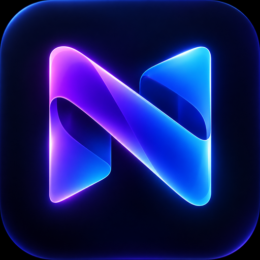
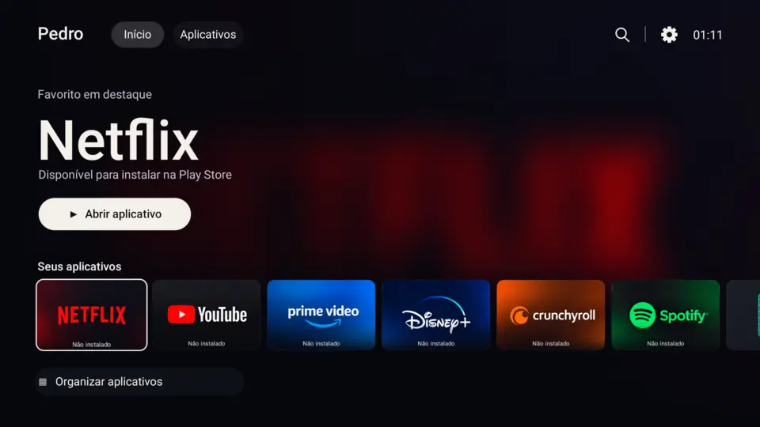

<p align="center">
  
</p>

<h1 align="center">Nexa TV</h1>

<h2 align="center">⬇️ CLIQUE ABAIXO PARA BAIXAR ⬇️</h2>

<p align="center">
  <a href="https://github.com/pedrobertanhi/Nexa-TV/releases/download/v4.6.1/Nexa-TV-4.6.1.apk">
    
  </a>
</p>

<h3 align="center">
  <a href="https://github.com/pedrobertanhi/Nexa-TV/releases/download/v4.6.1/Nexa-TV-4.6.1.apk">📺 TOQUE AQUI SE O BOTÃO NÃO ABRIR</a>
</h3>

---

<p align="center">
  Um launcher cinematográfico, leve e pensado para navegação por controle remoto no Android TV e Google TV.
</p>

<p align="center">
  <strong>Versão atual: 4.6.1 — Prévia assinada</strong>
</p>

<p align="center"><strong>Android TV e Google TV 8.0 ou superior</strong></p>

> [!IMPORTANT]
> Este é o repositório público oficial de distribuição. A versão 4.6.1 é uma
> prévia assinada para testes antes da versão final. Baixe somente pelos links
> deste repositório e confira a integridade antes de instalar.

## Download

Se o botão acima não aparecer, use o
**[link direto para baixar o APK](https://github.com/pedrobertanhi/Nexa-TV/releases/download/v4.6.1/Nexa-TV-4.6.1.apk)**.

- Android 8.0 ou superior;
- Android TV ou Google TV;
- SHA-256: `53a8d4a0005a2b74c83a11e765d78339211103dc80e32fe2142c68bf709223de`.
- certificado de assinatura: `f0c0d0d17e26e3207ec1ef285d08cce8599b1611267695ef02ee73506feaad0b`.

Baixe somente por este repositório. Consulte o **[tutorial completo](TUTORIAL.md)**
antes de instalar ou substituir uma versão anterior.

## Novidades da versão 4.6.1

- APK de distribuição assinado pela chave definitiva do Nexa TV.
- Verificação do certificado de assinatura e do SHA-256 durante a publicação.
- Atualizador mais seguro: versões SemVer, prévias durante a fase de testes,
  ETag, limite diário e URLs oficiais.
- Restauração de backup atômica: se o arquivo for inválido, nenhuma preferência
  é alterada.
- Build de release com R8 para reduzir e ofuscar o código.
- A 4.6.1 não oferece chave temporária pública. Recursos comerciais só devem ser
  liberados por uma chave legítima recebida do responsável pelo Nexa TV.

## Conheça o Nexa TV



O Nexa TV transforma a tela inicial da televisão em uma experiência limpa,
moderna e confortável para usar pelo controle remoto.

### Recursos Free

- Interface 16:9 otimizada para televisores.
- Navegação por setas, OK e Voltar.
- Organização, movimentação e ocultação de aplicativos.
- Fundo dinâmico conforme o aplicativo selecionado.
- Play Store mantida ao final da lista.
- Detecção de aplicativos instalados e removidos.
- Backup e restauração das preferências.
- Texto ampliado, alto contraste e movimento reduzido.

## Instalação resumida

1. Baixe o APK pelo link oficial acima.
2. Copie-o para um pendrive e conecte-o à TV.
3. Abra o arquivo usando um gerenciador de arquivos.
4. Autorize temporariamente a instalação por fontes desconhecidas.
5. Instale o Nexa TV e teste os aplicativos antes de configurá-lo como Home.
6. Revogue a autorização de fontes desconhecidas depois da instalação.

Para atualização, faça antes um backup em **Configurações → Backup e
restauração**. Se o Android indicar conflito de assinatura, leia o tutorial antes
de remover a instalação antiga.

## Compatibilidade

- Android TV ou Google TV 8.0 ou superior.
- Interface recomendada: Full HD, 1920 × 1080.
- Navegação completa por controle remoto.

A possibilidade de substituir o launcher depende do fabricante e do firmware. O
Nexa TV também funciona como aplicativo normal. Não remova nem desative o
launcher original do sistema.

## Privacidade

O Nexa TV não solicita contatos, localização, microfone ou armazenamento amplo.
A internet permanece desligada no fluxo de atualização até o usuário ativar a
opção ou tocar em verificar. Na futura edição comercial, também será usada na
ativação manual da licença. Preferências ficam no
armazenamento privado da TV. Consulte a [política de privacidade](PRIVACY.md).

## Verificar integridade

No computador, compare o SHA-256 do arquivo com `SHA256SUMS.txt`. Com o Android
SDK instalado, confira também o certificado:

```shell
sha256sum Nexa-TV-4.6.1.apk
apksigner verify --verbose --print-certs Nexa-TV-4.6.1.apk
```

Se qualquer valor divergir, não instale. Use [SECURITY.md](SECURITY.md) para
reportar APK falso ou suspeito.

## Projeto independente

Nexa TV é um projeto independente criado por **Pedro**. Não possui afiliação com
TCL, Google ou com os serviços exibidos. Todas as marcas pertencem aos seus
respectivos titulares.

© 2026 Pedro. Todos os direitos reservados. O código-fonte e os mecanismos
internos permanecem privados.
