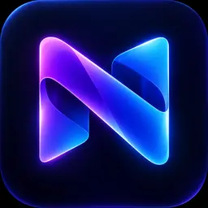
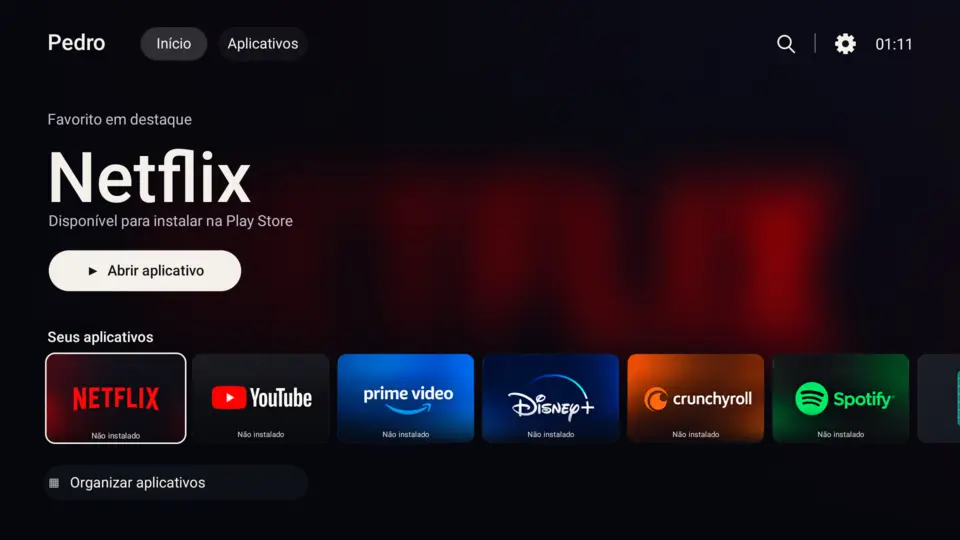

<p align="center">
  
</p>

<h1 align="center">Nexa TV</h1>

<p align="center">
  Um launcher cinematográfico, leve e pensado para navegação por controle remoto no Android TV e Google TV.
</p>

<p align="center">
  <strong>Versão atual: 4.2.0 Free Preview</strong>
</p>

<p align="center">
  <a href="https://github.com/pedrobertanhi/Nexa-TV/releases/download/v4.2.0/Nexa-TV-4.2.0-Free-Preview.apk">
    
  </a>
</p>

<p align="center"><strong>Android TV e Google TV 8.0 ou superior</strong></p>

> [!IMPORTANT]
> Este é o repositório público oficial de distribuição. A versão 4.2.0 disponível
> aqui é uma prévia Free para testar a nova interface. A ativação comercial Pro
> será liberada em um APK oficial depois da publicação do servidor de licenças.

## Download

Se o botão acima não aparecer, use o
**[link direto para baixar o APK](https://github.com/pedrobertanhi/Nexa-TV/releases/download/v4.2.0/Nexa-TV-4.2.0-Free-Preview.apk)**.

- Android 8.0 ou superior;
- Android TV ou Google TV;
- SHA-256: `b79a4a35ec939d8b785625425ef7f9ce57dc0f974453886cfa8285fd97062650`.
- certificado da prévia: `459cb753e9fcf554f58f977a092b5a4d81ba3b0028bbbc031bc86a09b3c69eab`.

Baixe somente por este repositório. Consulte o **[tutorial completo](TUTORIAL.md)**
antes de instalar ou substituir uma versão anterior.

## Novidades da versão 4.2.0

- Verificação automática de atualização desligada por padrão e limitada a uma vez por dia após consentimento.
- Inicialização da Home totalmente offline, inclusive para licenças próximas do vencimento.
- Backup limitado, validado e incapaz de importar licença ou ativar rede.
- Recuperação segura de preferências corrompidas para evitar loop de crash da Home.
- Estado de licença criptografado pelo Android Keystore.
- Metadados, tags e links de atualização tratados como entrada não confiável.
- Capas de aplicativos redimensionadas para reduzir risco de falta de memória.
- Política de privacidade, canal de segurança e instruções de verificação publicados.

## Conheça o Nexa TV



O Nexa TV transforma a tela inicial da televisão em uma experiência limpa,
moderna e confortável para usar pelo controle remoto.

### Recursos Free

- Interface 16:9 otimizada para televisores.
- Navegação por setas, OK e Voltar.
- Organização, movimentação e ocultação de aplicativos.
- Fundo dinâmico conforme o aplicativo selecionado.
- Play Store mantida ao final da lista.
- Detecção de aplicativos instalados e removidos.
- Backup e restauração das preferências.
- Texto ampliado, alto contraste e movimento reduzido.

## Instalação resumida

1. Baixe o APK pelo link oficial acima.
2. Copie-o para um pendrive e conecte-o à TV.
3. Abra o arquivo usando um gerenciador de arquivos.
4. Autorize temporariamente a instalação por fontes desconhecidas.
5. Instale o Nexa TV e teste os aplicativos antes de configurá-lo como Home.
6. Revogue a autorização de fontes desconhecidas depois da instalação.

Para atualização, faça antes um backup em **Configurações → Backup e
restauração**. Se o Android indicar conflito de assinatura, leia o tutorial antes
de remover a instalação antiga.

## Compatibilidade

- Android TV ou Google TV 8.0 ou superior.
- Interface recomendada: Full HD, 1920 × 1080.
- Navegação completa por controle remoto.

A possibilidade de substituir o launcher depende do fabricante e do firmware. O
Nexa TV também funciona como aplicativo normal. Não remova nem desative o
launcher original do sistema.

## Privacidade

O Nexa TV não solicita contatos, localização, microfone ou armazenamento amplo.
A internet permanece desligada no fluxo de atualização até o usuário ativar a
opção ou tocar em verificar. Na futura edição comercial, também será usada em
ações manuais de ativação e atualização da assinatura Pro. Preferências ficam no
armazenamento privado da TV. Consulte a [política de privacidade](PRIVACY.md).

## Verificar integridade

No computador, compare o SHA-256 do arquivo com `SHA256SUMS.txt`. Com o Android
SDK instalado, confira também o certificado:

```shell
sha256sum Nexa-TV-4.2.0-Free-Preview.apk
apksigner verify --verbose --print-certs Nexa-TV-4.2.0-Free-Preview.apk
```

Se qualquer valor divergir, não instale. Use [SECURITY.md](SECURITY.md) para
reportar APK falso ou suspeito.

## Projeto independente

Nexa TV é um projeto independente criado por **Pedro**. Não possui afiliação com
TCL, Google ou com os serviços exibidos. Todas as marcas pertencem aos seus
respectivos titulares.

© 2026 Pedro. Todos os direitos reservados. O código-fonte e os mecanismos
internos permanecem privados.
