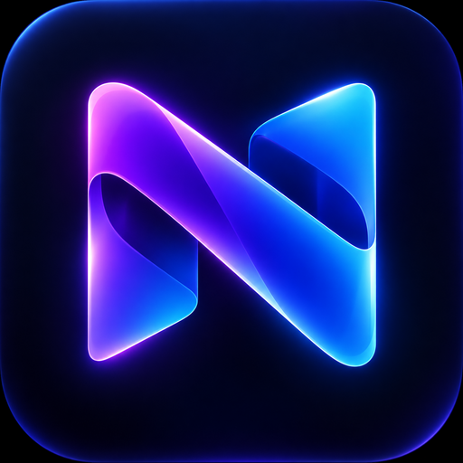

# Tutorial do Nexa TV 4.6.0



## Instalar na televisão

1. Baixe `Nexa-TV-4.6.0-Free-Preview.apk` pelo botão verde do README.
2. Copie o APK para um pendrive e conecte-o à TV.
3. Abra o arquivo com um gerenciador de arquivos.
4. Autorize temporariamente a instalação de apps desconhecidos para esse
   gerenciador, instale e depois revogue essa autorização.
5. Abra o Nexa TV e teste setas, OK, Voltar e a abertura dos aplicativos antes
   de configurá-lo como tela inicial.

## Usar o controle

- Setas: navegar.
- OK: abrir ou confirmar.
- Segurar OK em um cartão: começar a mover o aplicativo.
- Esquerda/direita durante o movimento: escolher a posição.
- OK novamente: salvar; Voltar: cancelar.
- Engrenagem: configurações, organização, backup e atualização.

## Desbloquear o aplicativo completo

1. Faça o pagamento único de **R$ 47,90** diretamente com Pedro.
2. Receba a chave por um canal privado.
3. Abra **Configurações → Nexa TV Completo → Ativar minha chave**.
4. Digite a chave e selecione **Desbloquear aplicativo**.
5. A licença comercial libera permanentemente todos os recursos em 1 TV.

A chave de teste da versão Free Preview funciona apenas no APK oficial de
prévia e expira em 25/11/2026. Ela não é uma licença comercial.

## Verificar o APK

SHA-256 esperado:

```text
11963500d324e974f6d7f45447d6919f82454e7eec8b2e82435ba93d36c741d5
```

Fingerprint SHA-256 do certificado da prévia:

```text
459cb753e9fcf554f58f977a092b5a4d81ba3b0028bbbc031bc86a09b3c69eab
```

Não instale se algum valor for diferente. Mantenha o launcher original do
Google TV instalado para poder voltar à interface do fabricante.
