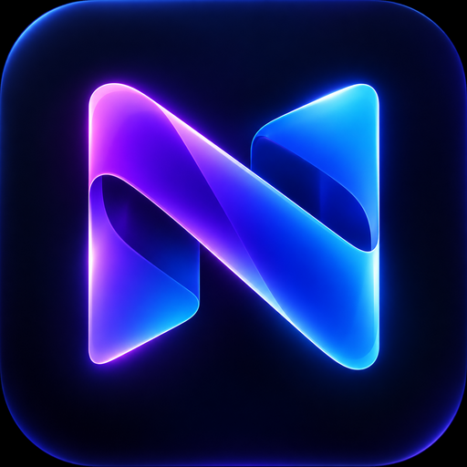

# Tutorial do Nexa TV 4.6.9



## Instalar na televisão

1. Baixe `Nexa-TV-4.6.9.apk` pela [Release oficial 4.6.9](https://github.com/pedrobertanhi/Nexa-TV/releases/tag/v4.6.9).
2. Copie o arquivo para um pendrive e conecte-o à TV.
3. Abra o APK por um gerenciador de arquivos.
4. Autorize temporariamente a instalação de apps desconhecidos para esse gerenciador.
5. Abra o Nexa TV e teste setas, OK, Voltar e a abertura dos aplicativos antes de configurá-lo como tela inicial.

## Usar o controle

- Setas: navegar.
- OK: abrir ou confirmar.
- Segurar OK em um cartão: começar a mover o aplicativo.
- Esquerda/direita durante o movimento: escolher a posição.
- OK novamente: salvar; Voltar: cancelar.
- Engrenagem: configurações, organização, backup e atualização.

## Desbloquear o aplicativo completo

1. [Fale comigo pelo Telegram](https://t.me/psychox7) para combinar o pagamento.
2. Receba uma chave legítima por canal privado.
3. Abra **Configurações → Nexa TV Completo → Ativar minha chave**.
4. Digite a chave e selecione **Desbloquear aplicativo**.

A chave é vinculada a uma TV. O aplicativo confere seu status no servidor ao abrir e ao voltar ao launcher. Uma chave cancelada ou inexistente retorna o app ao modo Free.

## Verificar o APK

SHA-256 esperado:

```text
e8a7dc69d6f7c0eee54115cd29111a885e01baebfad6c09f6519dd9fe0dd2748
```

Fingerprint SHA-256 do certificado:

```text
f0c0d0d17e26e3207ec1ef285d08cce8599b1611267695ef02ee73506feaad0b
```

Não instale se algum valor for diferente. Mantenha o launcher original do Google TV instalado para poder voltar à interface do fabricante.
